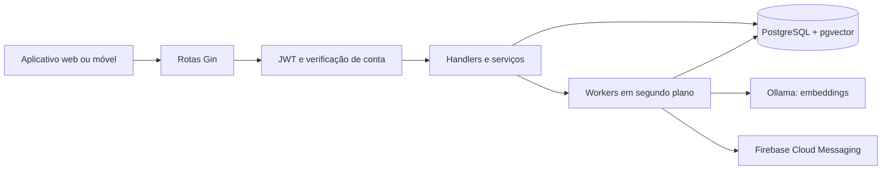

# Arquitetura

[Introdução](../README.md) · [Rotas](rotas.md) · Interface interativa: `/docs`

A API é uma aplicação Go com Gin, organizada por domínio. Os handlers recebem
HTTP, serviços aplicam regras e repositórios persistem dados com GORM no
PostgreSQL. Alguns domínios menores, como notificações e denúncias, concentram
parte dessas responsabilidades no próprio handler.

| Diretório | Responsabilidade |
| --- | --- |
| `cmd/api` | Composição, inicialização, workers e encerramento da API |
| `cmd/seed`, `cmd/embeddings` | Dados de desenvolvimento e reprocessamento de vetores |
| `internal/server` | HTTP, CORS, middleware e documentação interativa |
| `internal/auth`, `internal/access` | OAuth manual e verificações de permissão |
| `internal/database` | Conexão e diagnóstico do PostgreSQL |
| `internal/domain/session`, `user`, `uauth` | Identidade Google, sessão, usuários e JWT |
| `internal/domain/profile`, `applicant`, `teacher` | Criação, edição e consulta de perfis |
| `internal/domain/areas`, `areas_teacher` | Áreas e vínculos dos professores |
| `internal/domain/demand` | Ciclo de vida e acesso às demandas |
| `internal/domain/recommendation`, `embedding` | Vetores e ranking de recomendações |
| `internal/domain/notification`, `report` | Central de notificações, push e denúncias |

## Identidade e acesso

O aplicativo envia o ID token do Google para `POST /login/v2`. A API valida a
identidade, encontra ou cria a conta e devolve um JWT próprio, válido por 12
horas. Nas chamadas protegidas, o middleware valida o JWT e consulta a situação
atual da conta. Um usuário bloqueado recebe `403`, mas ainda pode acessar
`/me` com token válido para verificar o motivo. Não há refresh token.

Papéis: `demandante`, `professor` e `admin`. A atribuição inicial depende das
regras de e-mail em `internal/domain/user/user_model.go`; não existe endpoint
para promoção administrativa. Consultas e mutações têm permissões por recurso.

## Demandas e recomendações

Uma demanda passa de `cadastrada` para `emAnalise`, `emProducao` e `concluida`.
O demandante pode cancelar enquanto cadastrada; o professor atribuído pode
devolver uma análise. A reserva expira após 24 horas, devolvendo a demanda à
prateleira. Transações e locks evitam atribuições simultâneas. Um julgamento
procedente também pode cancelar a demanda.

O worker gera embeddings de 1024 dimensões para áreas e demandas usando Ollama;
o PostgreSQL/pgvector armazena os vetores. Recomendações comparam os vetores da
demanda com as áreas do professor. A geração ocorre em segundo plano e pode ser
reprocessada; dados sem vetor ainda não participam do ranking.

## Notificações e denúncias

A central HTTP persiste notificações por usuário e oferece contagem de não
lidas. Mudanças de estado, recomendações e denúncias geram avisos. Não há
WebSocket ou SSE; o aplicativo deve consultar a API para atualizar a tela.
Quando FCM está configurado, um worker envia push aos dispositivos já registrados.
O recebimento depende também da integração do aplicativo com FCM.

Professores ativos podem denunciar demandas acessíveis. Administradores listam
e julgam denúncias como `procedente` ou `improcedente`. Uma decisão procedente
cancela a demanda e aplica um strike ao demandante, no máximo uma vez por
demanda; três strikes bloqueiam a conta. Decisão, penalidade e notificações são
transacionais. As decisões são finais nesta versão.

## Inicialização e armazenamento

Na inicialização, a aplicação valida credenciais, conecta ao PostgreSQL, executa
migrações GORM e SQL, registra rotas e inicia workers de expiração, embeddings,
recomendação e, se configurado, push FCM. O esquema usa `AutoMigrate` sem
migrações versionadas ou rollback automático; valide alterações de esquema em
homologação e mantenha backups antes de publicar.
