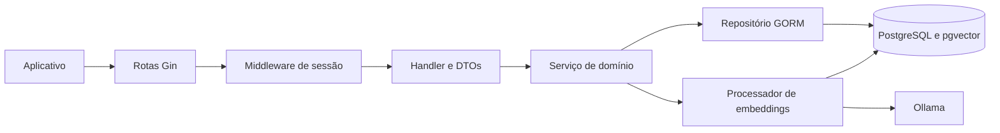
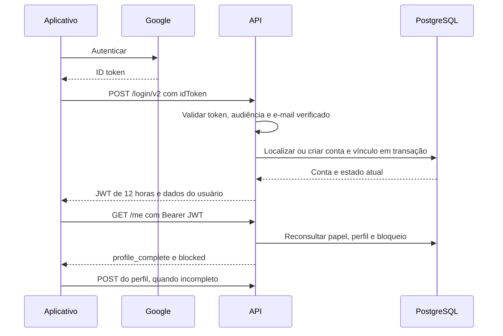
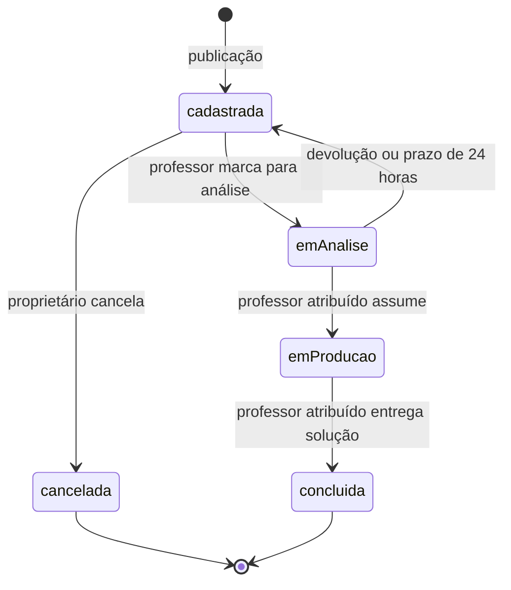

# Arquitetura e fluxos

[Índice da documentação](README.md) · [Rotas](rotas.md) · [Execução](configuracao.md)

## Organização da aplicação

A API é uma aplicação Go organizada por domínio. Gin recebe requisições HTTP;
os handlers decodificam entradas e produzem respostas; serviços aplicam regras;
repositórios executam consultas e transações com GORM/PostgreSQL.

Rotas públicas, como o login, não passam pelo middleware de sessão. O módulo
`recommendation` é uma exceção à divisão em camadas: seu handler executa a
consulta de ranking diretamente no banco.

| Caminho | Responsabilidade |
| --- | --- |
| `cmd/api/main.go` | Montagem das dependências, início do HTTP, rotina de expiração e encerramento |
| `cmd/seed/main.go` | Preparação do esquema e dados de demonstração |
| `cmd/embeddings/main.go` | Reprocessamento manual dos vetores pendentes |
| `internal/server` | Configuração HTTP, registro das rotas, middleware e login manual |
| `internal/auth` | Configuração OAuth Google usada pelo login manual no navegador |
| `internal/access` | Verificações reutilizáveis de administrador e propriedade |
| `internal/database` | Conexão PostgreSQL, configuração e diagnóstico de saúde |
| `internal/domain/session` | Validação de identidade Google, login, sessão e perfil atual |
| `internal/domain/user` | Conta, regras de papel, JWT e rotas administrativas de usuários |
| `internal/domain/uauth` | Modelo persistido do vínculo entre conta e identidade externa |
| `internal/domain/profile` | Escrita validada e transacional dos perfis |
| `internal/domain/applicant` e `teacher` | Modelos e consultas dos perfis |
| `internal/domain/areas` e `areas_teacher` | Áreas e associações com professores |
| `internal/domain/demand` | Contratos, permissões, persistência e estados das demandas |
| `internal/domain/recommendation` | Ranking de demandas para o professor |
| `internal/embedding` | Comunicação com Ollama e persistência dos vetores |

`profile` concentra as mutações de perfis; os pacotes `applicant` e `teacher`
mantêm as consultas. `uauth` mantém apenas o modelo: quem cria os vínculos de
identidade é o repositório de sessão, na mesma transação da conta.

## Inicialização e encerramento

1. Validar o segredo JWT e abrir a conexão com PostgreSQL.
2. Montar repositórios, serviços, handlers e processador de embeddings.
3. Configurar o OAuth do login manual. Na implementação atual essa configuração
   é obrigatória mesmo quando o aplicativo usa apenas `POST /login/v2`.
4. Executar as migrações atuais e registrar as rotas.
5. Iniciar a rotina de expiração de análises e o servidor HTTP.
6. Ao receber o sinal de encerramento, cancelar a rotina e conceder até cinco
   segundos para o encerramento HTTP.

As migrações usam `AutoMigrate` e SQL executado na inicialização. Também existe
uma conversão de associações antigas de áreas, com remoção de colunas antigas
após a conversão. Não há um sistema de migrações versionadas ou rollback
automático. Nem todos os erros de migração antigos são verificados. O seed
também altera o esquema; não é uma operação somente de inserção de dados.

## Modelo de dados

| Entidade | Relações principais |
| --- | --- |
| Usuário (`users`) | Conta com nome, e-mail, papel e foto |
| Identidade (`user_auths`) | Relaciona usuário a provedor e subject; o par identifica o login |
| Demandante (`demandantes`) | Perfil cujo ID corresponde ao ID da conta |
| Professor (`professors`) | Perfil cujo ID corresponde ao ID da conta |
| Área (`areas`) | Nome e embedding opcional |
| Associação (`professor_areas`) | Professor, área e tipo `técnica` ou `interesse` |
| Demanda (`demandas`) | Demandante obrigatório, professor opcional, área opcional e dados do ciclo de vida |

A classificação técnica/interesse pertence à associação do professor, e não à
área em si. O vínculo opcional de uma demanda com uma área não determina o
ranking: as recomendações comparam o texto da demanda com as áreas do professor.

Os DTOs de demanda e perfil não são cópias dos modelos persistidos. Eles limitam
campos expostos e editáveis. Áreas e usuários administrativos ainda retornam
modelos GORM diretamente; consulte as diferenças em [rotas](rotas.md).

## Login e preenchimento do perfil

A identidade usa o subject Google, não apenas o e-mail. Uma conta preexistente
com mesmo e-mail, mas sem vínculo correspondente, gera `409` em vez de associação
automática. Locks transacionais e unicidade protegem logins concorrentes.

O middleware valida o JWT e consulta novamente a conta em cada requisição
protegida. O papel do token não substitui o papel atual do banco. Conta removida
recebe `401`; bloqueada recebe `403`, com exceção de `/me`, que continua acessível
com um token válido para explicar o bloqueio.

Os papéis são `demandante`, `professor` e `admin`. No login, o padrão é
`demandante`; regras em `user_model.go` atribuem professor aos domínios
institucionais previstos e administrador a um e-mail fixo. Não existe endpoint
de promoção de papel. Essa política ainda não é configurável por ambiente.

Perfil incompleto não equivale a bloqueio. O middleware permite completar o
cadastro. Demandas exigem a existência do perfil correspondente e verificam
strikes/ativação; não exigem todos os critérios de `profile_complete` de `/me`.

## Ciclo de vida de uma demanda

O demandante cria a demanda sem informar proprietário, professor, estado ou
datas. Pode editar e cancelar somente enquanto ela está `cadastrada`. O
professor vê a prateleira (`cadastrada` e `emProducao`), mas só pode reservar uma
demanda cadastrada e sem professor. A lista `minhas` reúne suas atribuições.

Marcar para análise atribui o professor e grava um prazo de 24 horas. Apenas
esse professor pode devolver, assumir ou concluir a demanda nos estados
permitidos. Mutação usa transação e lock da linha; reservas concorrentes não
podem atribuir a mesma demanda a dois professores.

A API reconcilia reservas vencidas ao iniciar a rotina, a cada minuto e antes
das operações de demandas. Ao expirar, remove a atribuição e as datas da
análise, retornando à prateleira. O início da produção verifica novamente o prazo
após obter o lock. A conclusão mantém a atribuição e registra data e solução.

Cancelamento registra motivo e data, preserva a demanda para consulta e não usa
exclusão lógica do GORM. `DELETE /demands/:id` também cancela e exige motivo.
Não existe uma tabela geral de auditoria de todas as transições nem republicação.

Entradas, respostas e exemplos completos: [demandas.md](demandas.md).

## Embeddings e recomendações

Ao criar ou editar título/descrição de uma demanda ou nome de uma área, a API
sinaliza um worker em segundo plano que gera um vetor usando `mxbai-embed-large`,
com 1024 dimensões, sem bloquear a resposta do cadastro. O timeout por chamada é
de dois minutos, configurável por `OLLAMA_TIMEOUT`. Falhar não desfaz o cadastro:
o vetor permanece NULL, e o worker tenta novamente após um minuto do fim da
rodada ou ao receber um novo sinal. Na inicialização, também recupera os registros
pendentes, inclusive os anteriores à implantação. O banco é a fila durável;
os sinais em memória apenas antecipam a próxima rodada. O processamento é
sequencial por instância da API e é cancelado no encerramento. O comando
`cmd/embeddings` continua disponível para reprocessamento manual.

O processador só grava o vetor se o texto ainda corresponder ao usado na geração.
O texto de uma demanda contém título e descrição; público-alvo e impacto não
participam do embedding atual.

As recomendações consideram demandas cadastradas, sem professor, não canceladas,
não excluídas e com vetor. A maior similaridade ponderada entre as áreas do
professor determina a classificação: peso 0,8 para técnica e 0,5 para interesse.
Valores negativos são limitados a zero. Sem áreas/vetores utilizáveis, o resultado
é vazio. Após a gravação dos vetores, as recomendações passam a considerá-los;
a rotina de notificações verifica novas recomendações a cada 30 segundos.
